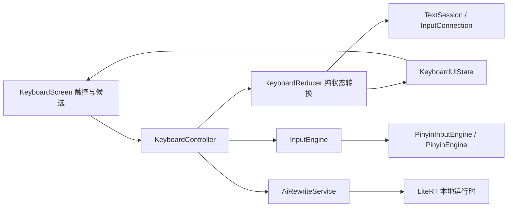

# 系统架构

## 1. 当前输入链路

代码根：`app/src/main/java/com/bitap/keyboard/`。

| 模块 | 责任 |
|---|---|
| `ime/BitapImeService.kt` | Android IME 生命周期、Compose 宿主、EditorInfo/selection 回调 |
| `ime/KeyboardController.kt` | 命令执行、后台查询、版本令牌、AI 请求和学习策略 |
| `core/KeyboardReducer.kt` | 纯状态转换，候选/空格/标点/pending 一致性规则 |
| `core/KeyboardUiState.kt` | 候选、语言、图层、编辑器能力、会话与版本 |
| `core/TextSession.kt` | InputConnection 封装、选区、提交、全选/复制/剪切/粘贴、Unicode 删除、按词移动与按词删除 |
| `core/engine/InputEngine.kt` | 可替换引擎及查询、候选、上下文、学习契约 |
| `core/EnglishPrediction.kt` | 英文常用词补全、用户 bigram 下一词、本地学习持久化边界 |
| `core/PinyinEngine.kt` | 索引、lattice 搜索、简拼、纠错、排序、用户学习 |
| `ime/KeyboardScreen.kt` | 按行多指处理、布局、候选 chip、展开面板、动效 |
| `ai/internal/` | 模型导入、提示、输出过滤、推理与生命周期 |
| `settings/`、`ui/` | 设置持久化、首次使用和应用界面 |

## 2. 一致性和线程要求

UI/编辑器命令由控制器协调，拼音计算在后台；不能把常规输入误述为主线程同步解码。查询包含 `sessionId`、`compositionVersion` 和合作式取消，回填及选词时校验归属。候选消费范围是原始输入偏移，不是汉字数。

查询异常通过 `KeyboardAction.PinyinQueryFailed` 进入 reducer：若同一 composing/version/session 有等待中的空格、候选或标点确认，则结束等待并回退原文（标点保留），随后按序回放排队按键；过期失败事件丢弃。协程 `CancellationException` 必须原样抛出，不能当作可展示的查询失败。词库加载由 `DictionaryLoadState { Loading, Ready, Failed }` 观察，失败只影响拼音候选，不清空 composing、不阻塞原文提交，并可由候选条重试。

Reducer 应保持可测试的状态转换；引擎不得访问 InputConnection、任意编辑器内容、剪贴板或网络。受限上下文由调用方按隐私策略提供，不能从接口契约存在推断当前自研引擎已利用前文。

编辑工具（全选/复制/剪切/粘贴/按词移动/按词删除）由 `KeyboardController` 在 dispatch 早期直接调用 `TextSession`，不经过 reducer 的文本命令，避免 reducer 变成隐藏编辑器；`SelectionChanged` 只同步 `hasSelection`，真实选区仍以编辑器回调为准。编辑入口位于候选条 AI 与设置之间，点击后打开独立键盘页 `EditingToolsPage`（两行八项主键 + 一行撤销/重做 + 提示），不向功能行追加临时行。`AndroidTextSession` 优先使用 `InputConnection.performContextMenuAction`，在目标编辑器不支持时退回选区读取 + 系统剪贴板 + `setSelection`/`commitText`；这些真实路径必须在设备/WebView/多行字段验证，JVM 的 `TestEditorTextSession` 只能证明逻辑。

光标左右移动不再占用功能行按键：`KeyboardScreen` 在空格下方留白处放置透明 `SpaceCursorPad`，长按后水平滑动，每 16dp 产生一次 `KeyboardAction.MoveCursor`，方向由拖动符号决定；只有竖屏非紧凑模式显示，避免压缩键位和候选面板高度。

英文补全/下一词由 `EnglishPredictor` 在本地完成：控制器跟踪当前英文单词前缀，空格/标点/回车时记录该词与前后 bigram；候选条显示最多3个“联想”chip，点击后替换前缀或插入下一词。只保存用户主动上屏的英文词和相邻 bigram（`EnglishPredictionStore`），不保存句子、上下文或密码字段；关闭学习时只提供内置常用词冷启动补全，不写入学习记录。

D07 连续中英数字混排基础版由两层组成：`KeyboardReducer` 在中文模式 Shift+首字母时进入 literal English run（保留大小写，字母/数字/`_`/`-` 连续追加，空格/回车/标点/退格/语言切换有确定语义，不发起拼音查询）；`EnglishLexicon` + `MixedInputResolver` 在 `PinyinInputEngine` 查询结果前补充“中文前缀 + 规范英文/数字后缀”候选（纯拼音已有完整 CJK 候选时完全不介入，最多3项，`CandidateSource.Other`）。词表为离线手写常用词/技术专名，不联网；涉及任意专名、小写开头 identifier 与真实设备输入仍需后续验证。

`InputEngine.query` 当前为同步接口，调用方负责后台调度。native 替换引擎仍需定义线程所有权、取消边界、会话销毁、返回值复制、部分消费和学习开关；宿主 full/partial 布尔标记不能代替生产消费范围。

## 3. 拼音解码与当前参数

生产资产 `app/src/main/assets/pinyin_dict.tsv` 包含65,999条词条，以及 Tatoeba 字符统计。词典、派生音节/简拼索引和词图共同生成候选，分数影响路径保留，因此某些“排序权重”变化也可能影响 oracle，不能声称必然是纯后置排序。

当前关键参数：

- 查询原始输入上限64字符：`PinyinEngine.search`仍直接拒绝>64；生产路径由`KeyboardController`保持完整`composing`，只向`InputEngine`查询最多64字符前缀；候选消费该前缀后，未消费拼音继续编辑并重新查询。查询失败时 `KeyboardController` 派发 `PinyinQueryFailed`，由 reducer 结束 pending 并原文回退。
- 词库加载状态：`DictionaryLoadState` 的 Loading/Ready/Failed 由 `BitapImeService.loadPinyinDictionary()` 发布；失败时中文候选条显示“词库加载失败，点此重试（仍可提交原文）”，重试重新加载，`onDestroy` 取消加载 Job。
- 长句实验接口（全部默认关闭，生产仍为 beam64/entries8）：`EngineTuning.longInputBeamSize/longInputEntriesPerKey` 只在显式调参时生效；`localCorrectionWindowEnabled/localCorrectionTailLimit/localCorrectionMaxWindow/localCorrectionBudget` 控制尾部窗口局部纠错。D05 预算消融与局部纠错诊断见[进度](PROGRESS.md)第11节；默认不启用任何实验字段。
- lattice beam=64、每key最多8项，返回候选上限64。
- 轻量 typo 查询长度上限12；有正常强候选时可能不触发。
- 长输入≥24时保留一个 early partial，当前放在5个 full 后；partial quota=16。
- 长输入边界实验（生产默认仍为FIXED）：`InputEngine.QueryInputMode`提供FIXED/SYLLABLE/WORD；`PinyinEngine.queryPrefixForBoundary`按至多64字符回退到音节或多字词边界。D05 dev 33条超预算句诊断见[进度](PROGRESS.md)第8节：64附近回退未优于固定64，短词边界24/40候选召回提高但操作成本上升，暂不切换。
- Partial排序实验（生产默认`SCORE`）：`EngineTuning.partialRankingMode`支持SCORE/LONGEST_FIRST/SHORTEST_FIRST；先冻结入选候选，所有模式的候选文本/消费集合一致、Top64命中不变，仅重排既定partial槽位。D05 natural Top1/Top5保持不变；SHORTEST_FIRST仅小幅提高Top8且命中样本平均消费长度16.26（SCORE17.70），整句完成仍1/33，未采用。详见[进度](PROGRESS.md)第9节。
- 展开候选面板按可见行固定高度：竖屏4行、紧凑2行；行高50dp、固定页脚48dp、内边距16dp（最大高度264/164dp）。候选chip在`FlowRow`中按自身宽度长短混排：短词多项同行，长词按自身宽度换行，不再每个候选独占一行；每页容量12项（竖屏）/8项（紧凑），长词或大字体超出时仅候选区内部滚动、页脚固定。页切换重置列表滚动，partial候选显示“分段”并提供“看分段”入口，引擎候选顺序不变。
- `WORD_NGRAM_WEIGHT=0.50`，此前0.35；`DICTIONARY_WORD_NGRAM_WEIGHT=0.4`。
- `SENTENCE_CORPUS_WEIGHT=0.0`、`SENTENCE_DICTIONARY_WEIGHT=0.0`；当前启用的是路径上下文/词内等统计信号，不能称为已启用整句后重排。
- 用户条目容量当前200；次数提升有界，并有衰减和清除 generation。

参数数值以源码为最终依据，改动后同步 [进度](PROGRESS.md) 并记录机制对照。

## 4. 本地 AI 生命周期

`DefaultAiRewriteService` 通过生命周期锁、epoch 和作业取消协调请求、卸载、删除及导入；`LiteRtQwenEngine` 延迟加载 native 引擎，并等待请求退出后释放。运行时以 CPU 为当前实现路径。

控制器和设置页均需传递 AI 开关；`cancel` 不等于卸载，`close` 不等于下次可重开。模型权重不随 APK 分发。生成峰值约1.9GB的历史风险依然存在，native释放成立不等于全部PSS场景达标。

保留 rewrite 服务代码用于后续独立需求，但没有生产 UI 入口，不作为当前功能宣称。独立 `:ai` 进程目前是可评估方案，未实现。

## 5. 安全与隐私边界

- Manifest 无 INTERNET/ACCESS_NETWORK_STATE；本机开发工具联网下载不等于应用联网。
- 密码不允许 AI 上下文，密码/禁学习字段不写用户词库。
- 学习可能保存用户词条，不能承诺“任何输入绝不落盘”；提供开关/清除，并限制保存内容。
- 模型文件在应用私有目录，系统备份关闭；输入正文和 AI 输出不得写普通日志。
- AI 结果需用户主动选择，过期会话或选区不得继续应用，不自动发送。

## 6. 引擎选型决定

继续使用 `PinyinInputEngine` 为生产默认。Rime 1.17.0 最小方案和同词表方案只完成 Windows 宿主实验，不能据速度或单一质量数字直接迁移。数据/方案/语言模型/候选组织仍不同，NDK/JNI与同设备预算没有证据。

下一次选型需同时给出实际可用方案的质量、候选消费、学习隐私、取消生命周期、设备内存/时延/包体和许可审查；不先整仓重写再寻找理由。
